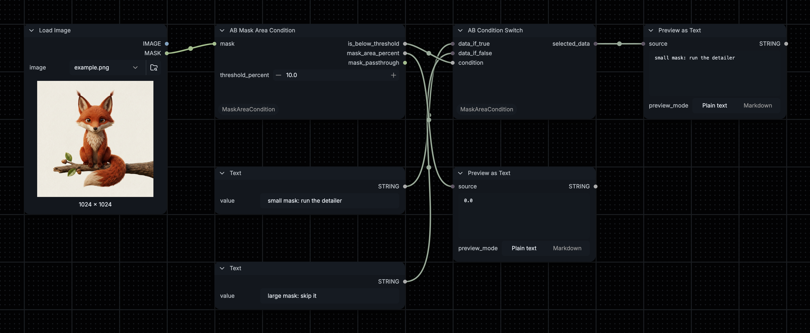

<div align="center">

# AB Mask Area Condition: run a detailer only when it helps, for ComfyUI

**Measure how much of the image a mask covers, and switch the workflow on that.**

<br />

[](https://github.com/a-und-b/ComfyUI_MaskAreaCondition/stargazers)
&nbsp;
[](https://registry.comfy.org/nodes/ComfyUI_MaskAreaCondition)
&nbsp;
[](https://registry.comfy.org/nodes/ComfyUI_MaskAreaCondition)
&nbsp;
[](LICENSE)

<br />



---

Face detailers fix small faces, and they cost time on every image, also on the ones where the face is already large and fine. AB Mask Area Condition measures the mask first and tells you whether it is below a threshold; AB Condition Switch then routes the workflow by that answer.

[Install](#install) · [Example workflow](#example-workflow) · [Nodes](#nodes) · [Contributing](#contributing)

</div>

---

## Why AB Mask Area Condition

You can build the same check from mask-statistics and math nodes, and the graph grows by four or five nodes for one decision. Here it is one node and a switch. No extra dependencies, no network calls.

## Features

| You want | You use |
|----------|---------|
| Run a detailer only on small faces | **AB Mask Area Condition** → `is_below_threshold` → **AB Condition Switch** |
| The mask size as a number | `mask_area_percent` (0–100) |
| Skip when nothing was detected | an empty mask always gives `is_below_threshold = False` |
| Pick one of two values of any type by a boolean | **AB Condition Switch** |

## Install

**ComfyUI Manager:** search for **AB Mask Area Condition**, install, restart ComfyUI.

**comfy-cli:**

```bash
comfy node install ComfyUI_MaskAreaCondition
```

**Manually:**

```bash
cd ComfyUI/custom_nodes/
git clone https://github.com/a-und-b/ComfyUI_MaskAreaCondition.git
```

Restart ComfyUI. **AB Mask Area Condition** appears under **AB/Mask**, **AB Condition Switch** under **AB/Utils**; search for `AB Mask` or `switch`.

## Example workflow

[`ab-mask-area-switch-by-mask-size.json`](example_workflows/ab-mask-area-switch-by-mask-size.json): **Load Image** gives a mask, **AB Mask Area Condition** measures it against 10 %, and **AB Condition Switch** picks "small mask: run the detailer" or "large mask: skip it". Drag the file onto the canvas, or open it in ComfyUI under Workflow → Browse Templates, under the pack's name. Point **Load Image** at an image with a mask, or connect a real mask source.

## Nodes

### AB Mask Area Condition

- `mask`: the mask to measure, for example a face or person detection.
- `threshold_percent`: below this share of the image, `is_below_threshold` is `True`.
- Outputs `is_below_threshold` (BOOLEAN), `mask_area_percent` (FLOAT) and `mask_passthrough`, the input mask for chaining.

### AB Condition Switch

- `data_if_true`, `data_if_false`: two inputs of any type (images, latents, masks, text …).
- `condition`: the boolean that picks one, for example `is_below_threshold`.
- Output `selected_data`.

Both nodes were called *Mask Area Condition* and *Select Data based on Condition* before 1.2.0; search still finds the old names, and saved workflows load unchanged.

## Use cases

- **Faster face detailing:** skip Face Detailer or ADetailer when the face mask is already large.
- **Different processing by object size:** apply other steps to small and large masked objects.
- **Routing:** send the workflow down one of two paths by a size rule.
- **Quality control:** treat masks that are too small or too large for the next step differently.

## Changelog

### v1.2.0
- New names and categories: **AB Mask Area Condition** (AB/Mask) and **AB Condition Switch** (AB/Utils); old names stay searchable
- Tooltips on every input; example workflow in ComfyUI's Templates dialog with a thumbnail

### v1.1.2
- Example workflow with preview image; node descriptions and a threshold tooltip

### v1.1.1
- Console logging of threshold, mask area and decision

### v1.1.0
- Removed the Gate nodes in favour of Select Data (now AB Condition Switch)
- An empty mask returns `False` for `is_below_threshold`

### v1.0.0
- Initial release

## Contributing

Bug reports and pull requests are welcome. Open an [issue](https://github.com/a-und-b/ComfyUI_MaskAreaCondition/issues) first for larger changes; [`CONTRIBUTING.md`](CONTRIBUTING.md) has the three steps.

## License

[MIT](LICENSE)

## Credits

- [Georg Neumann](https://www.linkedin.com/in/georg-neumann) from [KI Marketing Bootcamp](https://marketing-ki.de) for the initial code and concept

---

<div align="center">

Built by [Holger Will](https://github.com/a-und-b) at [anders & besser](https://andersundbesser.de)

<br />

[](https://github.com/a-und-b/ComfyUI_MaskAreaCondition/stargazers)

</div>
